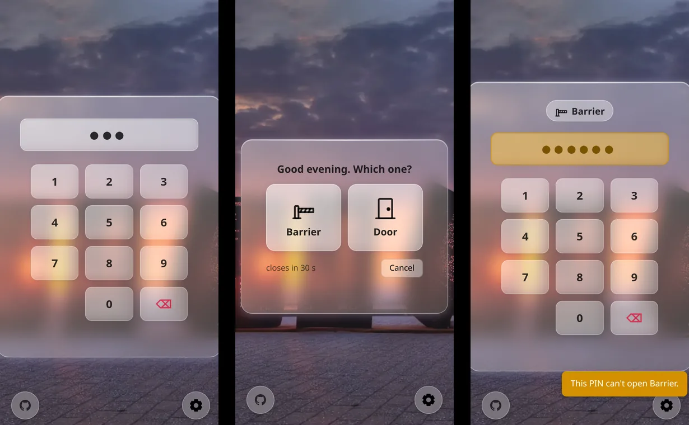
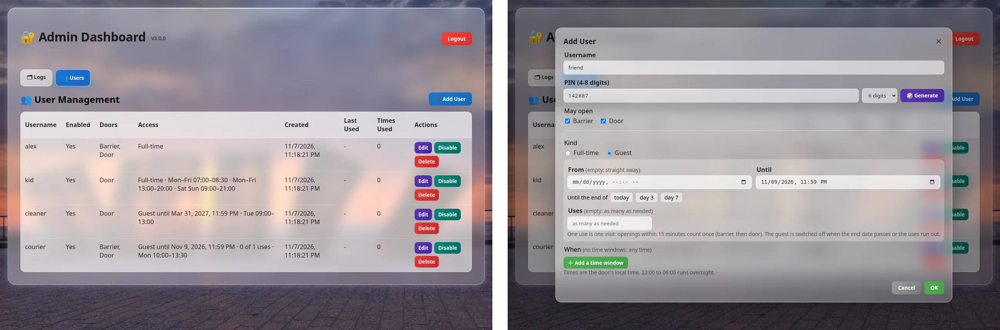

# DoorOpener

A PIN keypad in the browser for the doors, barriers and gates that your
[Home Assistant](https://www.home-assistant.io/) can open. Each person gets
their own PIN, their own doors and their own hours. Guests switch themselves
off when their stay ends. Strangers who guess PINs are blocked and you get an
alert.

[](https://github.com/leonardpitzu/DoorOpener/actions/workflows/ci.yml)




*The keypad: a PIN for two doors offers both; on the barrier's shortcut link, the owner of a door-only PIN is told why it doesn't open.*



*The admin panel: who may open what, and when; adding a friend as a guest for three days.*

## Contents

- [What it does](#what-it-does)
- [Two ways to run it](#two-ways-to-run-it)
- [Install as a Home Assistant app](#install-as-a-home-assistant-app)
- [Run it standalone, in Docker](#run-it-standalone-in-docker)
- [Configuration](#configuration)
- [Choose a setup: HTTPS, a reverse proxy, or plain HTTP](#choose-a-setup-https-a-reverse-proxy-or-plain-http)
- [Using it](#using-it)
- [Home Assistant events](#home-assistant-events)
- [Security](#security)
- [Upgrading](#upgrading)
- [API](#api)
- [How the code is laid out](#how-the-code-is-laid-out)
- [Development](#development)

## What it does

- **A keypad that works on any phone.** No app to install. It can sit on the
  home screen like one, and a PIN goes through after a short pause, without
  pressing ✓.
- **Several doors.** A door, a barrier, a gate or a garage door, each opened by
  a Home Assistant entity: `button`, `switch`, `lock`, `input_boolean`, `cover`
  or `script`.
  - A PIN that may open one door opens it at once.
  - A PIN that may open several shows a tile for each, and you tap the one you
    want.
- **Shortcut links.** `/barrier` or `/barrier+door` is the same link for
  everyone, for a QR code at the barrier or a home-screen icon of its own. The
  PIN still decides what opens.
- **People, not just PINs.** Tick the doors each user may open, and give them
  as many weekly time windows as needed. For example, the kids: weekdays
  07:00–08:30 and 13:00–20:00, weekends 09:00–21:00.
- **Guests who leave on time.** A guest has an end date and, if you like, a
  number of uses. When either runs out, they are switched off and stay in the
  list for next time.
  - One use is one visit: openings within 15 minutes count once (barrier in,
    door, barrier out).
- **Discreet.** The keypad says "Good evening", never whose PIN it was.
  - A refused PIN looks like any wrong one to a stranger.
  - Only its owner's own phone is told why, for example "Not now. You can open
    again tomorrow at 07:00.", so a child isn't left guessing.
- **Brute-force protection.** Per-device and per-browser blocks that double
  with each repeat, plus an alert in Home Assistant when wrong PINs pile up. It
  never locks out the people with the right PIN.
- **An admin panel** for users, PINs (with a generator that avoids `1234`) and
  the audit log. In Home Assistant it sits behind your Home Assistant login.
- **HTTPS served by DoorOpener itself.** Renewed certificates are picked up
  without a restart.
- **Home Assistant events** for openings and refusals, to build automations on.

## Two ways to run it

DoorOpener opens a door by asking Home Assistant to press, switch or open an
entity. It runs either as a Home Assistant app (an add-on), or as an ordinary
Docker container anywhere on your network that can reach Home Assistant.

| | Home Assistant app | Standalone container |
|---|---|---|
| **Runs on** | Home Assistant OS or Supervised, from the app store | Any Docker host |
| **Reaches Home Assistant** | Through the Supervisor: nothing to set up | `ha_url` and a long-lived access token |
| **Configured in** | The app's **Configuration** tab | `data/options.json`, plus a few environment variables |
| **Admin panel** | Inside Home Assistant (**Open Web UI**, or the sidebar), behind its login. Optionally also on the keypad port, with a password | On the keypad port at `/admin`, behind `admin_password` (required) |
| **HTTPS certificate** | The Let's Encrypt or DuckDNS app's files in `/ssl`, nothing to copy | Your certificate files, mounted into the container |
| **Time zone** | Home Assistant's | `TZ` |
| **Data** | `/data`, inside Home Assistant's backups | `./data` next to `docker-compose.yml`, for you to back up |
| **Secrets** | In the app's options, kept by the Supervisor | `options.json`, or environment variables and Docker secrets files |
| **Runs as** | Root, inside the app's container | Your own user (`PUID`/`PGID`), never root |
| **Updates** | Offered by Home Assistant (and automatic if you like) | `git pull` and a rebuild |

**Without any Home Assistant**, the standalone container starts anyway. The
keypad, PINs, schedules, guests, admin panel and audit log all work, but no door
opens. Each attempt says "Failed to contact Home Assistant", and the log says
"No Home Assistant configured". Turn on test mode to try everything out without
a door.

## Install as a Home Assistant app

1. **Settings → Apps → App Store → ⋮ → Repositories**, and add
   `https://github.com/leonardpitzu/DoorOpener`.
2. Find **DoorOpener** in the store and click **Install**.
3. On the **Configuration** tab, under **Doors**, add one entry per door, each
   with a name (`Barrier`), a link name (`barrier`) and the entity that opens it
   (`cover.parking_barrier`). The order is the order of the tiles.
4. Click **Start**. The keypad is on port 6532: `http://homeassistant.local:6532`.
5. **Open Web UI** opens the admin panel. Switch on **Show in sidebar** if you
   want it there too. Add your users and tick their doors.
6. To reach the keypad from outside your home, see
   [Choose a setup](#choose-a-setup-https-a-reverse-proxy-or-plain-http).
   Usually that means turning on **HTTPS** with the Let's Encrypt app's
   certificate and forwarding port 6532.

The app's **Documentation** tab has a shorter version of this page, written for
the Home Assistant side.

## Run it standalone, in Docker

Use this when Home Assistant runs as a container or in a VM without the
Supervisor, or when you want the keypad on another machine.

### What you need

- Docker with Compose 2.24 or later.
- A Home Assistant that the container can reach, for example
  `http://homeassistant.local:8123`.
- A long-lived access token for that Home Assistant: your profile → **Security**
  → **Long-lived access tokens** → **Create token**.
  - Use an administrator's token. Opening doors works with any user's token,
    but Home Assistant accepts DoorOpener's events only from an administrator.

### 1. Get the code

```bash
git clone https://github.com/leonardpitzu/DoorOpener.git
cd DoorOpener
```

### 2. Write the configuration

Everything the container keeps lives in one folder, `./data`. Start it with
your options:

```bash
mkdir data
cp options.json.example data/options.json
cp .env.example .env        # optional: time zone, port
```

In `data/options.json`, set at least:

- `doors`: your doors, as on the app's configuration page (see
  [Doors](#doors)).
- `settings.admin_password`: the admin panel's password. It is the only lock on
  the panel, so DoorOpener refuses to start with one shorter than 12
  characters, an empty one or a well-known default. To keep it out of the file,
  see [Keeping secrets out of options.json](#keeping-secrets-out-of-optionsjson).
- `ha_url` and `ha_token`: your Home Assistant and the token from above.

In `.env`:
- Set `TZ` to the door's time zone, for example `Europe/Bucharest`. Schedules
  and guests' dates are read in it, and it defaults to UTC.
- If your user is not 1000, set `PUID` and `PGID` to your user and group ids
  (`id -u`, `id -g`). The container runs as that user, never as root, so the
  files in `./data` belong to you.

### 3. Start it

```bash
docker compose up -d --build
docker compose logs -f dooropener     # look for "Connected to Home Assistant"
```

The keypad is at `http://<host>:6532` and the admin panel at
`http://<host>:6532/admin`. On the first start DoorOpener creates the rest of
`./data`:

| File | What it is |
|---|---|
| `options.json` | Your configuration (read only) |
| `users.json` | Users, their doors and rules, and their PINs, hashed with the PIN key |
| `pin_key` | The PIN key: without it, `users.json` cannot be searched for PINs. **Losing it loses every PIN** |
| `secret_key` | The key that signs logins, so they survive restarts. Losing it only logs you out |
| `logs/log.txt` | The audit log: the last 180 days, at most 5 MB |

Everything but `options.json` is readable by its owner (you) only. Back up the
whole folder: `users.json` without its `pin_key` is useless.

### Keeping secrets out of options.json

The admin password and the Home Assistant token can come from environment
variables or files instead of `options.json`:

| Secret | Variable | Or a file named by |
|---|---|---|
| Admin password | `DOOROPENER_ADMIN_PASSWORD` | `DOOROPENER_ADMIN_PASSWORD_FILE` |
| Home Assistant token | `DOOROPENER_HA_TOKEN` | `DOOROPENER_HA_TOKEN_FILE` |
| PIN key | | `DOOROPENER_PIN_KEY_FILE` (any secret of 32+ characters) |
| Login-signing key | `FLASK_SECRET_KEY` | `DOOROPENER_SECRET_KEY_FILE` |

`docker-compose.yml` has the Docker secrets lines ready, commented out: put each
secret in its own file under `./secrets`, readable by your user, and uncomment
them.

To keep the PIN key out of `./data` too, so that a copy of that folder holds no
way to the PINs, point `DOOROPENER_PIN_KEY_FILE` at a secret of its own. Then
back that secret up separately.

The admin password can also be stored as a hash, so that neither the file nor
the environment holds the password itself:

```bash
docker compose run --rm dooropener python pins.py hash-password
```

Put the `scrypt:...` line it prints in `admin_password`, or in the admin
password secret.

To serve HTTPS or sit behind a reverse proxy, see
[Choose a setup](#choose-a-setup-https-a-reverse-proxy-or-plain-http).

### Updating

```bash
git pull
docker compose up -d --build
```

Read [Upgrading](#upgrading) before a new major version.

### Without Compose

```bash
docker build -f Dockerfile.dev -t dooropener .
docker run -d --name dooropener --restart unless-stopped -p 6532:6532 \
  --user "$(id -u):$(id -g)" -e TZ=Europe/Bucharest \
  -e DOOROPENER_OPTIONS_PATH=/data/options.json -e USERS_STORE_PATH=/data/users.json \
  -e DOOROPENER_LOG_DIR=/data/logs -e DOOROPENER_SECRET_KEY_FILE=/data/secret_key \
  -e DOOROPENER_PIN_KEY_FILE=/data/pin_key \
  -v "$PWD/data:/data" dooropener
```

## Configuration

In the app, these are the fields of the **Configuration** tab. Standalone, they
are the same keys in `options.json`, with a few more at the end.

```json
{
  "doors": [
    {"name": "Barrier", "id": "barrier", "entity_id": "cover.parking_barrier", "icon": "barrier"},
    {"name": "Door", "id": "door", "entity_id": "button.intercom_open",
     "battery_entity": "sensor.intercom_battery"}
  ],
  "settings": {
    "ssl": false,
    "certfile": "fullchain.pem",
    "keyfile": "privkey.pem",
    "trusted_proxies": 0,
    "admin_password": "a-long-password",
    "report_to_ha": true,
    "max_attempts": 5,
    "session_max_attempts": 3,
    "block_time_minutes": 5,
    "max_global_attempts_per_hour": 50,
    "test_mode": false
  },
  "ha_url": "http://homeassistant.local:8123",
  "ha_token": "your-long-lived-access-token",
  "secret_key": ""
}
```

### Doors

One entry per door, in the order the keypad shows them.

| Key | What it is | |
|---|---|---|
| `name` | Shown on the keypad, e.g. `Barrier` | required |
| `id` | The link name: lowercase letters, digits, `-` and `_`. It makes the shortcut link (`/barrier`) and is how users' door ticks refer to the door, so keep it once users have the door | required |
| `entity_id` | What opens it: `button.*` (press), `switch.*` and `input_boolean.*` (turn on), `lock.*` (unlock), `cover.*` (open) or `script.*` (run) | required |
| `battery_entity` | A `sensor.*` with the opener's battery level in %, shown on the keypad | optional |
| `icon` | `door`, `barrier`, `gate` or `garage` | optional, `door` |

A door added later is opened by nobody until you tick it for a user. DoorOpener
refuses to start if two doors share an id, or if an id is one of the keypad's own
paths (`admin`, `static`, `health`, `battery`, `open-door`).

### Settings

| Key | What it does | Default |
|---|---|---|
| `ssl` | Serve HTTPS with the certificate below | `false` |
| `certfile` | The certificate with its full chain: a file name in `/ssl`, or a full path | `fullchain.pem` |
| `keyfile` | Its private key: a file name in `/ssl`, or a full path | `privkey.pem` |
| `trusted_proxies` | Reverse proxies in front of DoorOpener: `0` when browsers connect directly, `1` behind one | `0` |
| `admin_password` | The admin panel's password on the keypad port, at least 12 characters, or a hash from `python pins.py hash-password`. Required standalone. In the app it is optional, and without it the panel is only inside Home Assistant | |
| `report_to_ha` | Send openings, and refusals of someone's own PIN, to Home Assistant as events and logbook entries. The brute-force alert is sent either way | `true` |
| `max_attempts` | Wrong PINs from one IP address before it is blocked | `5` |
| `session_max_attempts` | Wrong PINs from one browser before it is blocked; also the wrong admin passwords allowed per IP address | `3` |
| `block_time_minutes` | The first block's length. Each repeat doubles it, up to 24 hours; a correct PIN resets it | `5` |
| `max_global_attempts_per_hour` | Wrong PINs per hour, from everyone together, that raise an alert. Never a lockout | `50` |
| `test_mode` | Go through the motions without opening any door, and without telling Home Assistant | `false` |

### Standalone only

The app gets these from the Supervisor. Standalone, they go at the top level of
`options.json`.

| Key | What it is | Default |
|---|---|---|
| `ha_url` | Home Assistant's address. A trailing `/api` is ignored | |
| `ha_token` | A long-lived access token, preferably an administrator's. Or `DOOROPENER_HA_TOKEN` / `_FILE` | |
| `ha_cert_pem` | Home Assistant's own certificate (PEM), when `ha_url` is HTTPS with a self-signed or private-CA certificate | |
| `port` | The port to listen on; `DOOROPENER_PORT` wins | `6532` |
| `secret_key` | The key that signs logins, 16+ characters; `FLASK_SECRET_KEY` wins. Leave it empty to have one kept in `DOOROPENER_SECRET_KEY_FILE` | |

And as environment variables (`docker-compose.yml` sets the paths for you):

| Variable | What it is |
|---|---|
| `TZ` | The door's time zone (default `UTC`) |
| `DOOROPENER_PORT` | The port, inside the container and on the host |
| `PUID`, `PGID` | The user and group the container runs as (default 1000) |
| `FLASK_SECRET_KEY` | A login-signing key, instead of a kept one |
| `DOOROPENER_ADMIN_PASSWORD`, `DOOROPENER_HA_TOKEN` (and `_FILE`) | Secrets, instead of `options.json` (see [above](#keeping-secrets-out-of-optionsjson)) |
| `DOOROPENER_OPTIONS_PATH`, `USERS_STORE_PATH`, `DOOROPENER_LOG_DIR`, `DOOROPENER_SECRET_KEY_FILE`, `DOOROPENER_PIN_KEY_FILE` | Where the files of `./data` are |
| `DOOROPENER_SSL_DIR` | Where certificate names without a folder are looked up (default `/ssl`) |
| `REQUESTS_CA_BUNDLE` | A CA bundle for Home Assistant's certificate, instead of `ha_cert_pem` |

An `options.json` from before 3.0, with a single `entity_id` (and
`battery_entity`) at the top level, still works as one door called Door. So does
one from before 2.10, with the settings at the top level.

## Choose a setup: HTTPS, a reverse proxy, or plain HTTP

How people reach the keypad decides two settings, `ssl` and `trusted_proxies`.
It works the same in the app and standalone; only where the certificate comes
from differs.

| Setup | `ssl` | `trusted_proxies` | Keypad address |
|-------|-------|-------------------|----------------|
| **A. DoorOpener serves HTTPS**: recommended when the keypad is reachable from the internet | `true` | `0` | `https://door.example.com:6532` |
| **B. Behind a reverse proxy or tunnel that does HTTPS**: NGINX Proxy Manager, a Cloudflare tunnel, Caddy, Traefik, ... | `false` | `1` | the proxy's address |
| **C. Plain HTTP, home network only** | `false` | `0` | `http://<host>:6532` |

**A.** DoorOpener serves HTTPS on its usual port. `certfile` and `keyfile` name
the certificate (with its full chain) and its private key. A bare file name is
looked up in `/ssl`; a full path is used as given.

- **In the app**, turn on **HTTPS**. With the Let's Encrypt app (or the DuckDNS
  app, if you have no domain of your own), that is all: it writes
  `fullchain.pem` and `privkey.pem` to `/ssl`, which are the defaults.
- **Standalone**, copy the two files to `./ssl`, owned by your user (the
  container is not root, and certbot's key is readable by root only), and
  uncomment the `./ssl:/ssl:ro` line in `docker-compose.yml`. A certbot deploy
  hook can copy them on every renewal. Or mount your certbot folder, if your
  user can read it, and give full paths:

  ```yaml
      volumes:
        - ./data:/data
        - /etc/letsencrypt:/etc/letsencrypt:ro
  ```

  ```json
  "settings": {
    "ssl": true,
    "certfile": "/etc/letsencrypt/live/door.example.com/fullchain.pem",
    "keyfile": "/etc/letsencrypt/live/door.example.com/privkey.pem"
  }
  ```

  Mount all of `/etc/letsencrypt`: the files in `live/` are links into
  `archive/`.

**Renewals need nothing.**
- Every new connection gets the certificate as it is on disk, so a renewed one
  is served at once.
- A renewal caught halfway (new certificate, old key) keeps the previous
  certificate until both files are in place.

**Things to know in setup A:**
- Open DoorOpener by the name on its certificate. An IP address gets a
  certificate warning, and plain `http://` no longer answers.
- DoorOpener refuses to start while the certificate or key is missing, or the
  two do not belong together. The log says which files it tried.
- A client must finish each request within 15 seconds, so slow connections
  cannot tie up the server.

**B.** The proxy does HTTPS. With `trusted_proxies` at `1`, the brute-force
limits see each visitor's own address, taken from the proxy's `X-Forwarded-For`.
DoorOpener believes that header only from a private, loopback or link-local
address, where your proxy runs. A client on the internet that reaches the port
around the proxy therefore cannot pick its own address.

With `0` behind a proxy, every visitor shares the proxy's address, so one
person's wrong PINs block everyone. Close port 6532 to the internet if you can.

**C.** Works out of the box, but PINs travel unencrypted: do not forward the
port to the internet this way.

**The session cookie follows the setup by itself**, with nothing to configure:
- HTTPS-only whenever the request came over HTTPS (A, and B through the proxy's
  `X-Forwarded-Proto`).
- A normal cookie over plain HTTP (C), where an HTTPS-only one would never come
  back and the keypad could not work.

### Home Assistant with a self-signed certificate

This is standalone only. If `ha_url` is HTTPS with a self-signed or private-CA
certificate, paste that certificate into `ha_cert_pem`:

```json
{
  "ha_cert_pem": "-----BEGIN CERTIFICATE-----\nMIIFTjCCA...\n-----END CERTIFICATE-----"
}
```

The host name in `ha_url` must be one of the names on that certificate.

## Using it

### The keypad

Enter a PIN.

- **One door:** if the PIN may open one door, that door opens.
- **Several doors:** if it may open several, a tile for each appears for 30
  seconds; tap one. Each PIN entry opens one door, so barrier and then door
  means entering the PIN twice.
- **Shortcut links:** `/barrier` opens straight to that door, and
  `/barrier+door` to those two. The link is the same for everyone and the PIN
  decides which of its doors may open.
  - Add a shortcut to the home screen and it becomes an icon of its own, named
    after its doors.
  - On Android, a long press on the main icon offers each door.
- **What it says:** it greets by the time of day on the phone, never by name,
  and shows each door's battery level when the door has a sensor.

### Users and guests

In the admin panel's **Users** tab:

- **PIN:** 4 to 8 digits, unique per user. **🎲 Generate** picks one nobody has
  and nobody would guess first. PINs are stored hashed, so pass a PIN on when
  you create it; nobody can read it back.
- **May open:** the doors this user may open.
- **Full-time or guest:**
  - A full-time user has no end date.
  - A guest has an **Until** date (with buttons for the end of today, day 3 and
    day 7), optionally a start, and optionally a number of **uses**.
- **When:** add as many time windows as needed, each a set of days and hours.
  No windows means any time, and 22:00 to 06:00 runs overnight.

For example:

| Who | Set up as |
|---|---|
| The kids | Full-time, door only. Mon–Fri 07:00–08:30 and 13:00–20:00, Sat–Sun 09:00–21:00 |
| A friend staying three days | Guest until the end of day 3, any number of uses |
| A courier | Guest until Monday, 1 use, Monday 10:00–13:30 |
| The cleaner | Guest until the end of the contract, Tuesdays 09:00–13:00 |

**When a guest is done** (end date passed or uses used up), they are switched
off on their own. They stay in the list, marked expired or used up. Next time,
tick **Enabled** and give a new end date; their uses start afresh.

**Visits and windows:** a visit outlasts the end of a window, so someone who came
through the barrier at 13:29 can still open the door at 13:31. Times are the
door's local time.

**Refusals:**
- Outside its window, a PIN is answered like any wrong PIN, so a stranger cannot
  tell it exists.
- A phone that has opened a door with that same user's PIN is told why, and
  those tries do not count as wrong ones:
  - "Not now. You can open again tomorrow at 07:00."
  - "This PIN expired on Sun 9 Nov."
  - "This PIN can't open Barrier."
- A new PIN makes DoorOpener forget the phones that knew the old one.

### The audit log

The **Logs** tab lists every attempt: when, from which address, whose PIN, which
door, and the result. That includes wrong PINs, blocks, refusals with their
reason, guests switched off, and admin actions.

The log is circular. It keeps the last 180 days and at most 5 MB, and the oldest
entries make room for new ones.

## Home Assistant events

With `report_to_ha` on (the default), DoorOpener tells Home Assistant:

| Event | When | Data |
|---|---|---|
| `dooropener_door_opened` | Every opening, plus a logbook entry ("Barrier opened by alice") | `user`, `door`, `door_name`, `entity_id` |
| `dooropener_access_refused` | Someone's own PIN refused | `user`, `reason` (`outside_schedule`, `expired`, `used_up`, `not_yet_valid`, `not_allowed`, `disabled`), `doors` tried (empty from the main link) |

Trigger an automation on them to be told when the kids get home, when the
cleaner arrives, or when someone tries outside their hours. A PIN that matches
nobody is not an event; too many of those raise the brute-force alert instead.
That alert is a persistent notification with the id `dooropener_alert`. Test
mode sends neither events nor alerts.

## Security

| Layer | What it does |
|---|---|
| **Per-device blocks** | An IP address is blocked after `max_attempts` wrong PINs. Keyed on the address alone, so changing headers buys nothing |
| **Per-browser blocks** | A browser is blocked after `session_max_attempts` wrong PINs |
| **Growing blocks** | The first block lasts `block_time_minutes`, and each repeat doubles it, up to 24 hours. A correct PIN resets it |
| **Admin login limits** | Per IP address, with the same backoff, after `session_max_attempts` wrong passwords |
| **Alerts, not lockouts** | `max_global_attempts_per_hour` wrong PINs within an hour raise a Home Assistant notification. A lockout for everyone would hand an attacker a way to keep you out |
| **No PIN oracle** | A disabled PIN, one outside its window, or one for another door is answered and counted like any wrong PIN. Only the owner's own phone, holding a signed cookie that a new PIN invalidates, is told why |
| **One-time door choice** | The tiles' pass is kept on the server: it works once, from the browser that entered the PIN, for 30 seconds |
| **Hashed PINs** | `users.json` holds scrypt hashes, never PINs, keyed with the PIN key: a copy of `users.json` alone cannot be searched for PINs (scrypt alone would give a 4-digit PIN away in minutes). Older stores are converted on load, without any PIN changing |
| **Missing PIN key** | DoorOpener refuses to use `users.json` without its PIN key, or with another one, rather than make a new key and void every PIN |
| **Admin password** | At least 12 characters, or stored as a scrypt hash; standalone it can come from a Docker secret instead of `options.json` |
| **Private files** | `users.json`, `pin_key`, `secret_key` and the audit log are readable by their owner only; the standalone container runs as your user, never root |
| **Admin inside Home Assistant** | In the app, the admin panel is reached through ingress, behind the Home Assistant login. Without `admin_password` it is not on the keypad port at all |
| **Admin session expiry** | Checked on the server: 12 hours, or 30 days with "remember me", which bounds a stolen cookie |
| **Startup checks** | DoorOpener refuses to start with an empty or default admin password, a guessable secret key, `ssl` on without a usable certificate, or doors that cannot work |
| **HTTPS** | Served by DoorOpener itself; renewed certificates are picked up without a restart; slow clients get 15 seconds per request |
| **Input limits** | PINs are 4 to 8 digits, and request bodies are capped at 64 KiB |
| **Headers** | A Content Security Policy allowing only DoorOpener's own scripts, `X-Frame-Options: DENY` (`SAMEORIGIN` for Home Assistant's frame), `nosniff`, a strict referrer policy, and `no-store` for anything that is not a static file |

## Upgrading

- **3.1**
  - **The PIN key.** On the first start DoorOpener creates `pin_key` next to
    `users.json` and keys the stored PINs with it. No PIN changes. From then on,
    `users.json` needs `pin_key`: back them up together.
  - **The admin password** must be at least 12 characters (or a hash). A
    shorter one stops DoorOpener from starting, and the log says so.
  - **Standalone:** the container runs as your user (`PUID`/`PGID`, default
    1000), no longer root. Files that root made in `./data` before need to be
    given back to you once: `sudo chown -R $(id -u):$(id -g) data`.
- **3.0**
  - **The door is now a list of doors.**
    - The app: Home Assistant does not carry the old door entity over, so add
      your door again under **Doors**, as the first entry, and restart.
    - Standalone: an `options.json` with the old `entity_id` keeps working as
      one door.
  - **Users:** existing users get the first door, and doors you add later need
    ticking. One-time PINs became guests with 1 use.
  - **Logs:** the rotated log files are folded into the one circular log.
  - **Standalone files:** `docker-compose.yml` now keeps everything in `./data`.
    Move `options.json`, `users.json` and `logs/` there, and, if you used one,
    the key file named in `DOOROPENER_SECRET_KEY_FILE` as `data/secret_key`.
- **2.10**: DoorOpener's own settings moved into a **settings** section. Home
  Assistant does not carry values across such a move, so check them once after
  updating.
- **2.8**: PINs are stored hashed. Plain-text PINs are converted on the first
  start; backups made before then still hold them in plain text.

## API

Every error is JSON: `{"status": "error", "message": "..."}`.

| Method | Path | What it does |
|---|---|---|
| `GET` | `/` | The keypad |
| `GET` | `/<door>[+<door>...]` | A shortcut page for those doors |
| `POST` | `/open-door` | `{"pin": "...", "doors": [...]}`, with `doors` sent only from a shortcut page. One door: opened, `{"status": "success", "door": "..."}`. Several: `{"status": "choose", "pass": "...", "doors": [...]}`. Refused on the owner's phone: `403 {"status": "refused", "message": "..."}` |
| `POST` | `/open-door/choice` | `{"pass": "...", "door": "..."}`: the tile picked, within 30 s, from the same browser |
| `GET` | `/battery?door=<id>` | A door's battery level: `{"level": 85}`, or `null` |
| `GET` | `/manifest.webmanifest[?to=<doors>]` | The web app manifest, or a shortcut's own |
| `GET` | `/health` | `{"status": "ok", "version": "..."}`, for health checks |
| `GET` | `/admin` | The admin panel |
| `POST` | `/admin/auth`, `/admin/logout`; `GET` `/admin/check-auth` | Admin login on the keypad port |
| `GET` | `/admin/logs` | The audit log |
| `POST` | `/admin/logs/clear` | `{"mode": "all"}` or `{"mode": "test_only"}` |
| `GET` | `/admin/users` | The users, with their `doors`, `access` rules and visits, and the configured `doors` |
| `POST` | `/admin/users` | Create a user: `username`, `pin`, `doors`, optionally `access` |
| `PUT` | `/admin/users/<name>` | Change any of `pin`, `active`, `doors`, `access` (`null` clears it) |
| `DELETE` | `/admin/users/<name>` | Delete a user |
| `GET` | `/admin/generate-pin?length=6` | A random PIN that nobody has and nobody would guess first |

The admin endpoints need a login on the keypad port. Through Home Assistant's
ingress they need none: Home Assistant has signed the user in, and only its
administrators get in. Requests that change something carry an `X-CSRF-Token`.

`access` is `null`, meaning always, or:

```json
{
  "valid_from": "2026-11-10T08:00",
  "valid_until": "2026-11-12T23:59",
  "uses": 3,
  "schedule": [
    {"days": [0, 1, 2, 3, 4], "hours": ["07:00", "20:00"]},
    {"days": [5, 6], "hours": null}
  ]
}
```

- `valid_until` makes the user a guest. `valid_from` and `uses` need it.
- Times are the door's local time.
- `days` run from Monday = 0; `null` means every day.
- `hours` set to `null` means all day.
- Any one row of `schedule` lets the PIN in.

## How the code is laid out

| Module | What it does |
|---|---|
| `dooropener/app.py` | The Flask app: routes, the PIN → door flow, refusals, the admin API |
| `dooropener/config.py` | Reads `options.json` and the environment: doors, settings, startup checks |
| `dooropener/access.py` | When a PIN works: a guest's dates and uses (counted per visit), schedules |
| `dooropener/users_store.py` | Users in one JSON file, written atomically: hashed PINs, doors, rules, visits, guests switched off |
| `dooropener/passes.py` | The 30-second pass between a PIN for several doors and the tile picked |
| `dooropener/phones.py` | The signed cookie that recognises a user's own phone |
| `dooropener/security.py` | Blocks with backoff, the brute-force alarm, client identity, security headers, trusted proxies |
| `dooropener/pins.py` | PIN rules, hashing and the PIN key, admin password hashes (`python pins.py hash-password`), the generator |
| `dooropener/audit.py` | The circular audit log |
| `dooropener/ha_client.py` | Home Assistant calls: opening doors, battery levels, events, logbook, alerts; skipped without Home Assistant |
| `dooropener/ingress.py` | The admin panel inside Home Assistant (the app only) |
| `dooropener/tls.py` | The HTTPS certificate, reloaded when its files change, and the slow-client deadlines |
| `dooropener/gunicorn.conf.py` | The server: port, HTTPS, one worker with threads; shared by the app and the container |
| `dooropener/config.yaml`, `translations/en.yaml`, `DOCS.md` | The Home Assistant app: manifest, configuration page texts, documentation tab |
| `Dockerfile.dev`, `docker-compose.yml` | The standalone container |

## Development

You need Python 3.12 or later.

```bash
python -m venv .venv && source .venv/bin/activate
pip install -r requirements-dev.txt
cp options.json.example dooropener/options.json
# in it: set a real admin_password, and "test_mode": true to open nothing
python dooropener/app.py                          # http://localhost:6532
```

Tests, lint and the security scan, as CI runs them:

```bash
pytest tests/ --cov=dooropener --cov-fail-under=75
ruff check dooropener/ tests/
bandit -q -r dooropener/
```

CI (`.github/workflows/ci.yml`) runs these on every push and pull request, and
builds both images: the standalone `Dockerfile.dev` and the app's own
`dooropener/Dockerfile`. Dependabot proposes dependency updates monthly.

A release is a pull request to `master` that bumps `version` in
`dooropener/config.yaml`. Home Assistant offers the update once it is merged.

## License

MIT; see [LICENSE](LICENSE).
